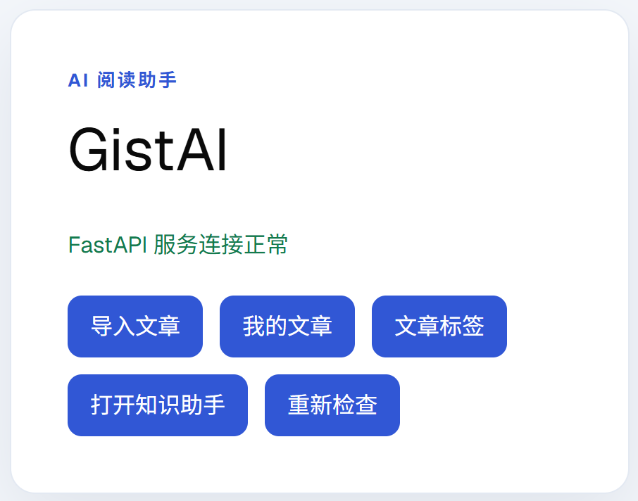
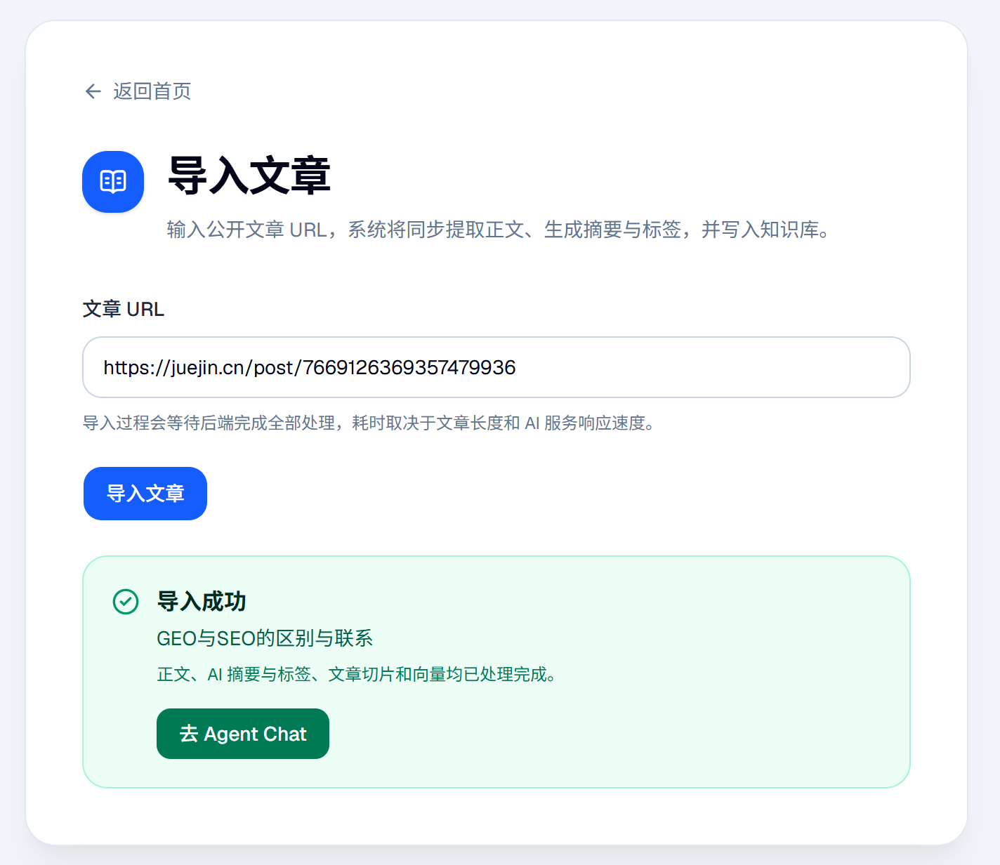
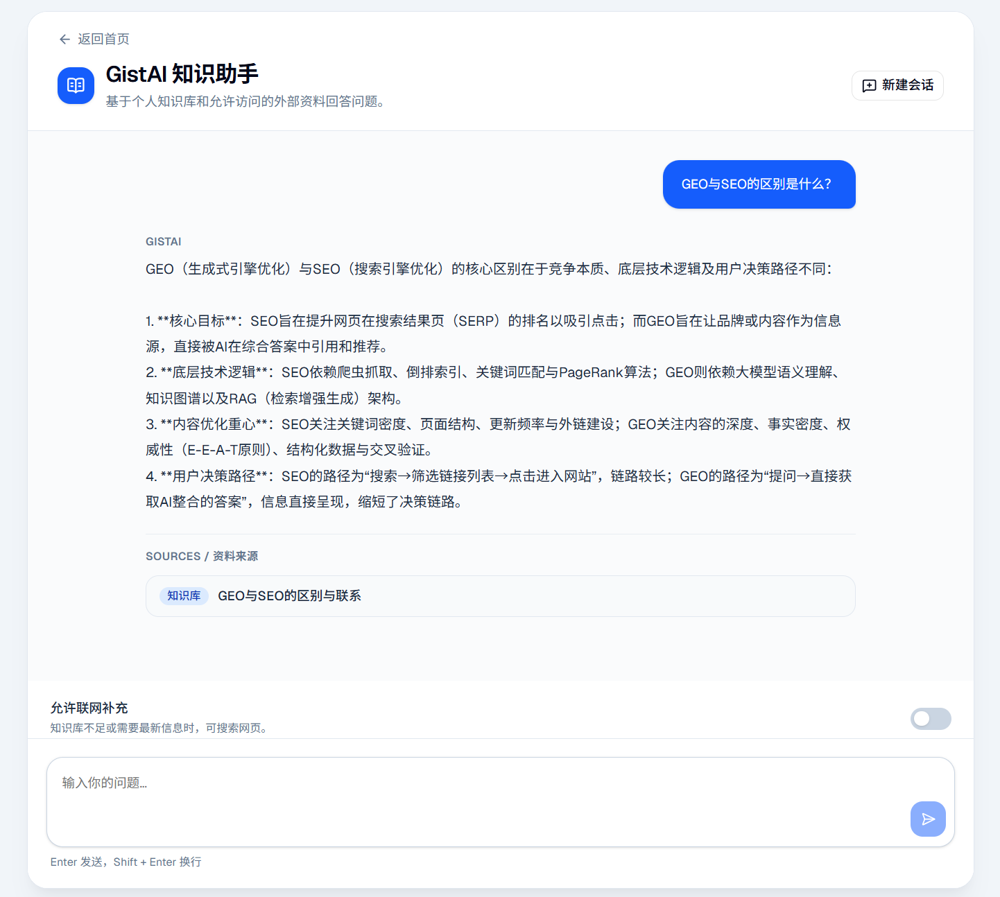
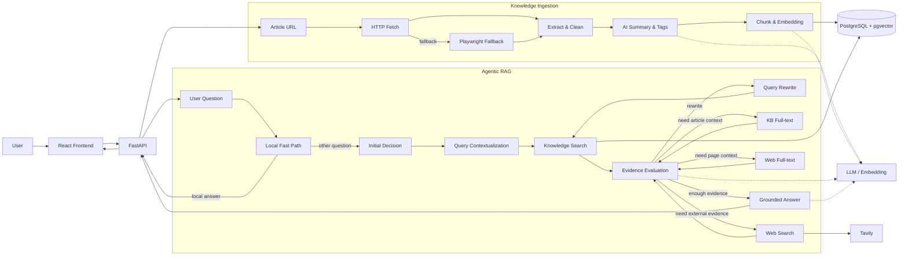

# GistAI

一个面向个人知识管理场景的 AI 阅读助手。

GistAI 可以把网页文章抓取、清洗、摘要并写入个人知识库，再通过语义检索和 Agentic RAG 完成基于证据的问答。对于需要最新信息的问题，也可以在用户允许的情况下调用 Web Search，并继续读取网页全文补充证据。

> 核心设计原则：确定性强的流程保持普通 Workflow；需要运行时判断的知识使用过程交给 Agent。

---


## Screenshots

### 首页



### 文章导入

从公开文章 URL 开始，完成正文提取、AI 摘要与标签、Chunk 和 Embedding，并写入知识库。



### 知识助手

基于个人知识库进行问答，并展示实际使用到的 KB / Web Sources。



---

## Features

- URL 导入文章
- HTTP 抓取 + Playwright fallback
- 正文提取与清洗；抓取失败后可手动粘贴正文并继续 AI / Embedding 处理
- 文章列表与详情、分页跳转、按主题筛选、标题编辑与无标题时的 URL 回退展示
- AI 摘要、核心观点与主题；正式主题和待整理主题可分别管理，一篇文章可关联多个主题
- Token Chunking + Embedding
- PostgreSQL + pgvector
- Keyword Search / Semantic Search
- Basic RAG
- 多轮 Agent Chat
- Query Contextualization
- Query Rewrite
- Controlled Web Search
- KB / Web Full-text Reading
- Evidence Selection
- Runtime Policy / Tool Budget
- PostgreSQL Conversation Checkpoint
- 问候、感谢、告别和受控句式会话状态问题的本地快速回答
- KB / Web Sources 展示

摘要直接呈现内容与关键依据，避免机械复述文章结构；待整理主题可在管理页提升为正式主题、归入已有主题或忽略。

---

## Architecture

GistAI 分为两条核心链路：

- **Knowledge Ingestion**：把外部文章转成可检索的个人知识。
- **Agentic RAG**：根据用户问题和当前证据，决定搜索、改写 Query、读取全文、联网补充或直接回答。



程序负责本地快速路径、权限、工具预算、合法 Action 和终止条件；LLM 只在允许范围内做语义判断。

---

## Tech Stack

### Frontend

- React
- TypeScript
- Vite
- React Router
- TanStack Query
- axios
- Tailwind CSS
- shadcn/ui

### Backend

- Python
- FastAPI
- Pydantic
- SQLAlchemy 2
- Alembic
- PostgreSQL
- pgvector
- LangGraph

### AI & Retrieval

- OpenAI-compatible LLM API
- OpenAI-compatible Embedding API
- Semantic Search
- Structured Output
- Query Rewrite
- Evidence Selection
- Tavily Web Search

### Fetching

- HTTP
- trafilatura
- Playwright
- SSRF Protection

---

## Project Structure

```text
GistAI/
├─ apps/
│  ├─ web/          # React frontend
│  └─ server/       # FastAPI backend
├─ docs/
├─ infra/
├─ docker-compose.yml
├─ .env.example
└─ README.md
```

---

## Quick Start

以下命令以 Windows PowerShell 为例，从项目根目录开始。需要 Python、Node.js / npm 和 Docker Desktop；各项外部服务参数见 `.env.example`。

### 1. Configure & Start PostgreSQL

在项目根目录执行：

```powershell
Copy-Item .env.example .env
```

`.env.example` 的本地数据库连接与 `docker-compose.yml` 的默认配置一致。先在本机 `.env` 中填写所需的 LLM、Embedding 和 Web Search 服务配置，再启动数据库：

```powershell
docker compose up -d postgres
docker compose ps
```

确认 `gistai-postgres` 健康检查通过。不要提交 `.env` 或真实密钥。

### 2. Install Backend & Run Database Migration

```powershell
Set-Location apps/server
python -m venv .venv
.\.venv\Scripts\python.exe -m pip install --upgrade pip -i https://mirrors.aliyun.com/pypi/simple/
.\.venv\Scripts\python.exe -m pip install -r requirements.txt -i https://mirrors.aliyun.com/pypi/simple/
.\.venv\Scripts\python.exe -m playwright install chromium
.\.venv\Scripts\python.exe -m alembic upgrade head
```

### 3. Start Backend

在 `apps/server` 目录执行：

```powershell
.\.venv\Scripts\python.exe -m uvicorn app.main:app --reload --host 127.0.0.1 --port 8000
```

FastAPI Swagger:

```text
http://127.0.0.1:8000/docs
```

### 4. Start Frontend

另开一个 PowerShell 窗口，在项目根目录执行：

```powershell
Set-Location apps/web
npm install --registry=https://registry.npmmirror.com
npm run dev
```

访问：

```text
http://127.0.0.1:8088/
```

默认端口为前端 `8088`、后端 `8000`、PostgreSQL `5432`。前后端可在各自终端按 `Ctrl+C` 停止；数据库可从项目根目录执行 `docker compose stop postgres`。

---

## Environment

完整功能依赖以下外部服务：

- PostgreSQL + pgvector
- OpenAI-compatible LLM API
- Embedding API
- Tavily API Key
- Playwright / Chromium

其中：

- PostgreSQL 用于业务数据、Vector Search 和 Agent Checkpoint
- LLM 用于摘要、Query Rewrite、Evidence Evaluation 和最终回答
- Embedding 用于文章和 Query 向量化
- Tavily 用于 Web Search
- Playwright 用于普通 HTTP 抓取失败后的浏览器 fallback

实际环境变量请参考项目中的 `.env.example`。

---

## Agent Design

### Evidence-driven Decision

```text
Retrieval Results
↓
Evidence Evaluation
↓
Selected Evidence
↓
Answer
```

核心原则：

> Retrieval Success ≠ User Goal Satisfied

如果当前 Chunk 或 Search Snippet 不足以回答问题，Agent 可以继续执行 Query Rewrite、全文读取或 Web Search。

问候、感谢、告别、身份询问，以及会话是否延续、是否是新对话和先前聊天是否保留等受控完整句式，会在知识检索前本地回答。该路径根据当前用户 checkpoint 中已有的真实消息判断会话状态，不调用模型、Embedding、知识检索或 Web Search；普通知识问题仍由 Agent 处理。前端在页面切换和刷新后保留当前会话及 `thread_id`，服务端按用户隔离 checkpoint。

### Controlled Web Search

系统区分：

```text
allow_web
= 是否允许联网

requires_freshness
= 当前问题是否要求最新证据
```

当问题明确要求“今天”“最新”“当前”等时，如果用户允许联网且预算可用，系统会优先补充 Web Evidence。

### Bounded Agent Loop

Agent 不允许无限调用工具。

当前主要限制：

```text
MAX_KB_SEARCHES    = 2
MAX_REWRITES       = 1
MAX_WEB_SEARCHES   = 1
MAX_ARTICLE_READS  = 2
MAX_WEB_PAGE_READS = 2
MAX_STEPS          = 8
```

程序负责权限、预算、合法 Action 和终止条件；LLM 只在允许范围内做语义判断。

---

## Reliability & Security

项目包含以下工程保护：

- SSRF 防护
- localhost / Private IP 拦截
- Redirect 逐跳校验
- Playwright 导航安全控制
- Structured Output
- Pydantic Validation
- Runtime Business Validation
- Transaction
- Atomic Replacement
- Error Classification
- User / Thread Isolation
- PostgreSQL Checkpoint

文章重新处理和 Embedding 重建会先完整准备新结果，再通过事务替换旧数据，避免中途失败破坏已有有效数据。

---

## API

Agent Chat:

```text
POST /api/v1/agent/chat
```

Request:

```json
{
  "message": "用户当前问题",
  "thread_id": "可选 UUID"
}
```

Response（`data` 为实际回答）：

```json
{
  "code": 20000,
  "message": "Agent 回答成功",
  "data": {
    "thread_id": "UUID",
    "answer": "回答内容",
    "status": "answer",
    "sources": []
  }
}
```

前端每轮只发送当前消息和 `thread_id`，会话状态由后端 PostgreSQL Checkpoint 维护。

---

## Tests

后端测试覆盖：

- KB Search → Answer
- KB Search → Full-text → Answer
- Follow-up Query Contextualization
- No-Web 场景
- Freshness → Web Search
- Web Search → Web Full-text → Answer
- Article Import → Embedding → Agent Retrieval
- PostgreSQL Checkpoint 跨实例恢复
- 会话状态快速路径及非会话问题的反向保护

运行后端测试需要独立的测试数据库。前端可在 `apps/web` 目录执行 `npm run build` 检查生产构建。

---

## Current Scope

当前实现是一个 **single-agent、bounded、evidence-driven Agentic RAG system**。

暂未包含：

- Long-term Memory
- Cross-conversation Memory
- Conversation History / Rename / Delete UI
- 历史对话内容自动总结
- Streaming / SSE / WebSocket Chat
- Multi-Agent
- Planner / Reflection
- Reranker
- Web 内容自动保存
- Agent Analytics Dashboard

这些能力会根据后续真实产品需求决定是否加入。
